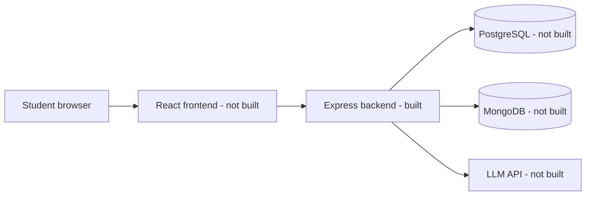

# TeamFinder - HLD

## Overview
TeamFinder is a web app. It has a React frontend, an Express backend and two databases. An LLM is used to read resumes.

## Diagram


## Parts of the system
| Part | What it does | Status |
|---|---|---|
| React frontend | Pages for login, hackathons and matches | Not built |
| Express backend | API, login, validation and the main logic | Built, only the health route so far |
| PostgreSQL | Stores users, hackathons, interests, teams and requests | Not built |
| MongoDB | Stores parsed resumes, LLM output and logs | Not built |
| LLM API | Turns resume text into structured data and writes explanations | Not built |

## How the backend is organised
```
routes -> controllers -> services -> database
```
- Routes: the URL paths.
- Controllers: take the request and send back the response.
- Services: the actual logic.
- Database part: runs the queries.

I kept them separate so each part does only one job and it is easy to test.

## Why I made these choices
- Two databases: things like "which user is looking for which hackathon" are relations, so I use PostgreSQL. Resume data and LLM output can look different every time, so I use MongoDB for that.
- The LLM only reads and explains. The ranking and scoring is done by my own code, so I can test it and explain it.
- Secrets are kept in a .env file which is not pushed to GitHub. The .env.example file shows which values are needed.
- A resume is parsed only once and the result is saved, so I don't call the LLM again and again.

## Other things
- Errors: all errors go through one error handler and return the same format.
- Security: passwords will be hashed and login will use JWT. Resumes are shown only to logged in students.
- Config: the app checks the environment variables when it starts.