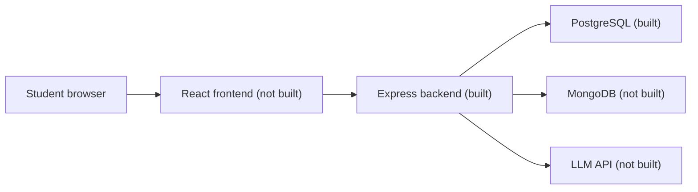

# TeamFinder - HLD

## Overview
TeamFinder is a web app. It has a React frontend, an Express backend and two databases. An LLM is used to read resumes.

## Diagram


## Parts of the system
| Part | What it does | Status |
|---|---|---|
| React frontend | Pages for login, hackathons and matches | Not built |
| Express backend | API, login, validation and the main logic | Built: health, auth and hackathon routes |
| PostgreSQL | Stores users, hackathons, interests, teams and requests | Built: users, hackathons and interests tables, hosted on Neon |
| MongoDB | Stores parsed resumes, LLM output and logs | Not built |
| LLM API | Turns resume text into structured data and writes explanations | Not built |

## How the backend is organised
```
routes -> controllers -> services -> database
```
- Routes: the URL paths.
- Controllers: take the request and send back the response.
- Services: the actual logic and the SQL queries.
- Database part: the connection to Postgres.

I kept them separate so each part does only one job and it is easy to test.

Middleware runs before the controllers. I have a request logger, a JWT auth check, an id validator, a body validator, a not found handler and one central error handler.

## How login works
1. The user registers. The password is hashed with bcrypt and only the hash is saved.
2. The user logs in. The typed password is compared with the saved hash.
3. If it matches, the server sends back a signed JWT with the user id and an expiry time.
4. For protected routes, the client sends the token in the Authorization header. The auth middleware checks the signature using a secret from .env and then loads the user.

## Why I made these choices
- Two databases: things like "which user is looking for which hackathon" are relations, so I use PostgreSQL. Resume data and LLM output can look different every time, so I will use MongoDB for that.
- The LLM only reads and explains. The ranking and scoring is done by my own code, so I can test it and explain it.
- Secrets (database URL and JWT secret) are kept in a .env file which is not pushed to GitHub. The .env.example file shows which values are needed.
- A resume is parsed only once and the result is saved, so I don't call the LLM again and again.
- Login errors always say "Invalid email or password", so nobody can find out which emails are registered.

## Other things
- Errors: all errors go through one error handler and return the same format.
- Security: passwords are hashed, login uses JWT, and request bodies are validated. There are no refresh tokens yet, so a token works until it expires (1 day).
- Config: the app checks the environment variables when it starts.
- Database connection: I use Neon's WebSocket driver to connect to Postgres, because direct Postgres connections kept getting reset on my network. The tables and SQL are the same as with the normal pg library.